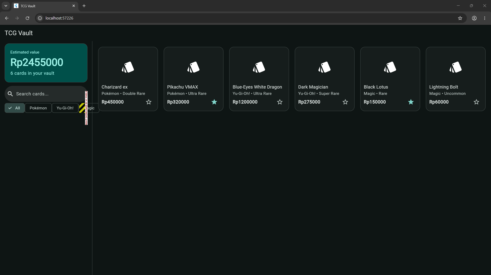
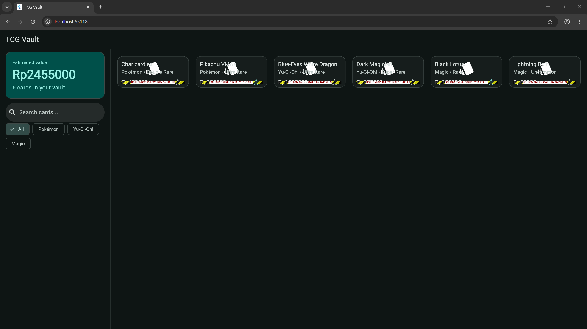
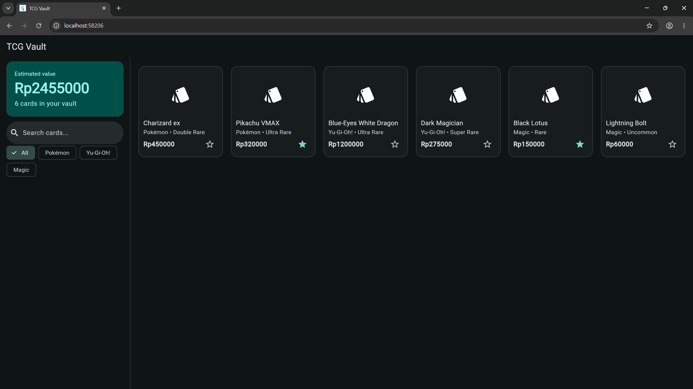
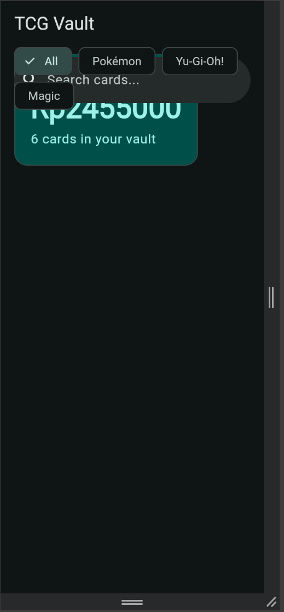
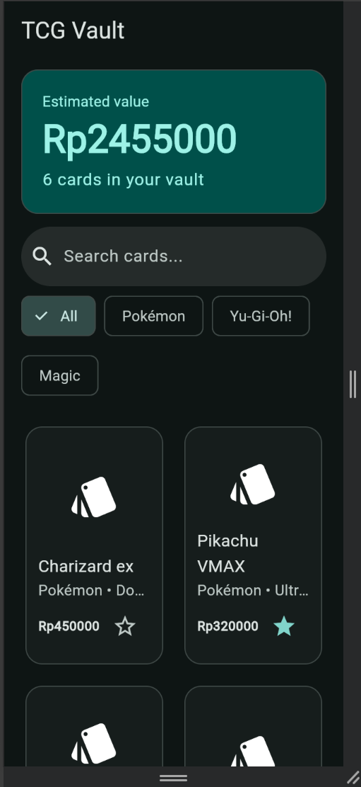

# Minggu 4 — H2 Diagnosis constraint

---

## 1. Row: overflow di sisi kanan

**Screenshot error:** `constraints_1_error.png`




**Aturan yang dilanggar (satu kalimat):** `Row` memberi anak non-flex lebar tak terbatas di sumbu utamanya, jadi keempat chip memakai lebar alaminya (total sekitar 340 dp) walaupun ruang yang tersedia hanya sekitar 288 dp, dan `Row` tidak pindah ke baris baru seperti `Wrap`, sehingga sisanya meluap ke kanan.

**Kode yang rusak** (`Wrap` diganti `Row`, `spacing` dan `runSpacing` dihapus):

```dart
child: Row(
  children: [
    ChoiceChip(
      label: const Text('All'),
      selected: selected == null,
      onSelected: (_) => onSelected(null),
    ),
    for (final name in brandNames)
      ChoiceChip(
        label: Text(name),
        selected: selected == name,
        onSelected: (_) => onSelected(name),
      ),
  ],
),
```

**Perbaikan** (kembali ke `Wrap`, yang pindah baris saat ruang habis):

```dart
child: Wrap(
  spacing: 8,
  runSpacing: 8,
  children: [
    ChoiceChip(
      label: const Text('All'),
      selected: selected == null,
      onSelected: (_) => onSelected(null),
    ),
    for (final name in brandNames)
      ChoiceChip(
        label: Text(name),
        selected: selected == name,
        onSelected: (_) => onSelected(name),
      ),
  ],
),
```
**Screenshot setelah diperbaiki:** `constraints_1_fixed.png`


---

## 2. Column: overflow di sisi bawah

**Screenshot error:** `constraints_2_error.png`



**Aturan yang dilanggar (satu kalimat):** Grid hanya mengizinkan tinggi 100 dp untuk setiap `CardTile`, tetapi `Column` di dalamnya meletakkan nama, brand, dan baris harga pada tinggi alaminya (sekitar 92 dp ditambah padding 24 dp) yang lebih besar, dan `Column` tidak menyusutkan atau menggulir anaknya, jadi sisanya meluap ke bawah.

**Kode yang rusak:**

```dart
gridDelegate: const SliverGridDelegateWithMaxCrossAxisExtent(
  maxCrossAxisExtent: 240,
  mainAxisExtent: 100, 
  mainAxisSpacing: 12,
  crossAxisSpacing: 12,
),
```

**Perbaikan:**

```dart
gridDelegate: const SliverGridDelegateWithMaxCrossAxisExtent(
  maxCrossAxisExtent: 240,
  mainAxisExtent: 232, 
  mainAxisSpacing: 12,
  crossAxisSpacing: 12,
),
```

**Screenshot setelah diperbaiki:** `constraints_2_fixed.png`



---

## 3. Grid di dalam Column: viewport tanpa batas tinggi

**Screenshot error:** `constraints_3_error.png`



**Aturan yang dilanggar (satu kalimat):** `Column` memberi anak non-flex tinggi tak terbatas, sedangkan `GridView` memperluas dirinya mengisi tinggi yang diberikan, jadi ia menerima "tak terhingga" dan tidak bisa memutuskan seberapa tinggi dirinya.

**Kode yang rusak:**

```dart
Widget _compactLayout(List<TcgCard> visible) {
  return Column(
    children: [
      ..._controls(),
      GridView.builder(
        padding: const EdgeInsets.all(16),
        gridDelegate: const SliverGridDelegateWithMaxCrossAxisExtent(
          maxCrossAxisExtent: 240,
          mainAxisExtent: 232,
          mainAxisSpacing: 12,
          crossAxisSpacing: 12,
        ),
        itemCount: visible.length,
        itemBuilder: (context, i) {
          final card = visible[i];
          return CardTile(
            key: ValueKey(card.id),
            card: card,
            onToggleFavorite: () => _toggleFavorite(card.id),
          );
        },
      ),
    ],
  );
}
```

**Perbaikan** (`GridView` dibungkus `Expanded`):

```dart
Widget _compactLayout(List<TcgCard> visible) {
  return Column(
    children: [
      ..._controls(),
      Expanded(
        child: GridView.builder(
          padding: const EdgeInsets.all(16),
          gridDelegate: const SliverGridDelegateWithMaxCrossAxisExtent(
            maxCrossAxisExtent: 240,
            mainAxisExtent: 232,
            mainAxisSpacing: 12,
            crossAxisSpacing: 12,
          ),
          itemCount: visible.length,
          itemBuilder: (context, i) {
            final card = visible[i];
            return CardTile(
              key: ValueKey(card.id),
              card: card,
              onToggleFavorite: () => _toggleFavorite(card.id),
            );
          },
        ),
      ),
    ],
  );
}
```

**Screenshot setelah diperbaiki:** `constraints_3_fixed.png`



---